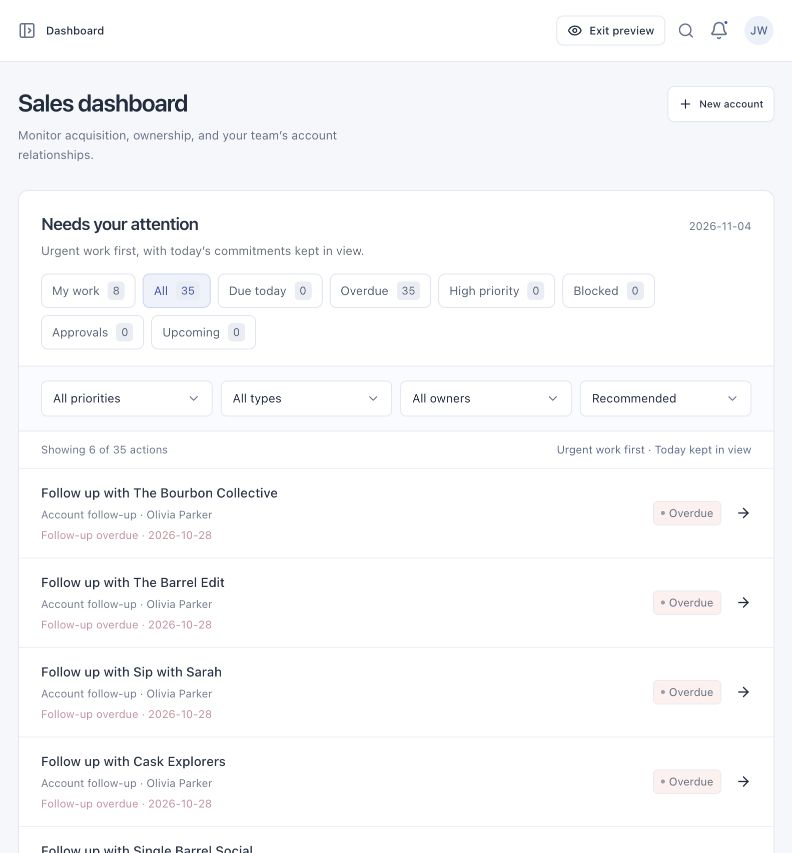
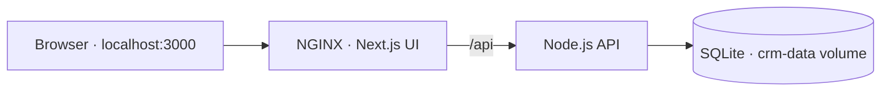

# Bottle Nexus CRM

One workspace for customer relationships, brand launches, and daily operations.

[Quick start](#quick-start) · [Workspaces](#workspaces) · [How it runs](#how-it-runs) · [Testing](#testing)

<p align="center">
  
</p>

> **Prototype:** uses sample records and selectable demo users. Real sign-in, payments, email, and external integrations are not connected.

## Quick start

### Docker — shared local database

Requires Docker with Compose. No host Node.js installation needed.

```sh
docker compose up -d --build --wait
```

Open **[localhost:3000](http://localhost:3000)**.

| Action | Command |
| --- | --- |
| View logs | `docker compose logs -f` |
| Stop | `docker compose down` |
| Restart or apply changes | `docker compose up -d --build --wait` |

Your data survives stops and rebuilds. **Adding `-v` to `docker compose down` deletes the database volume.** [Backup instructions →](docs/technical-reference.md#local-database-operations)

<details>
<summary><strong>Develop without Docker</strong></summary>

Requires Node.js **22.18+**.

```sh
npm ci
npm run dev
```

Open [127.0.0.1:3000](http://127.0.0.1:3000). This mode saves data in your browser; use Docker for shared SQLite persistence.

</details>

## Workspaces

| Workspace | Main jobs |
| --- | --- |
| **Brands** | Manage accounts, complete onboarding, prepare launches |
| **Affiliates** | Track partner pipelines, relationships, and follow-ups |
| **Operations** | Assign work, resolve cases, review brand approvals |

Shared records connect all three. Search, saved views, filters, and bulk actions help you find and update work.

**Try a role:** choose a user in **Demo role**, then click **See as** for that same role’s clean UI. **Exit preview** restores demo controls. Preview keeps the same permissions and sample data; edits still save.

## How it runs



**UI:** Next.js, React, TypeScript, Tailwind, Radix

**Local backend:** Node.js, SQLite, Docker Compose

| Folder | Contains |
| --- | --- |
| [`src/components/`](src/components/) | Screens and shared UI |
| [`src/lib/`](src/lib/) | Data, permissions, and workflow rules |
| [`server/`](server/) | API, validation, migrations, and backups |
| [`tests/`](tests/) | Data, API, and browser checks |

## Testing

Install dependencies and Chromium once, then run the complete checks:

```sh
npm ci
npx playwright install chromium
npm run test:scenarios
```

Runs TypeScript checks, data/API tests, a production build, and desktop/mobile browser scenarios. The command prints a dated HTML report under `reports/user-journeys/`. Tests use temporary databases.

[Browser test guide](tests/e2e/README.md) · [GitHub checks](https://github.com/nadia825/bn-crm/actions) · [Technical reference](docs/technical-reference.md)
